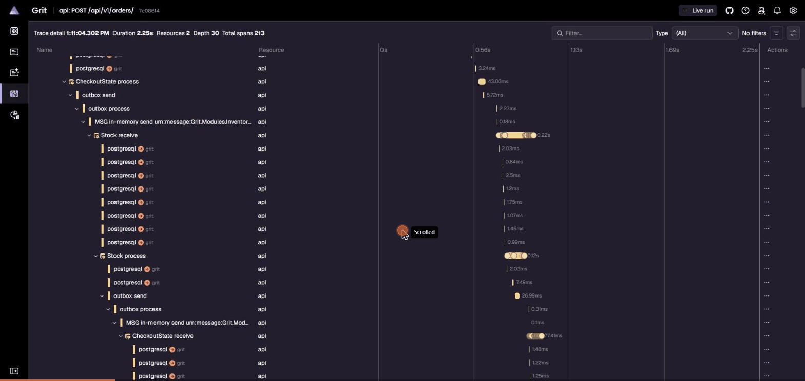

# Grit Store

**English summary.** Grit Store is a portfolio e-commerce for sports apparel and footwear: a **.NET 10 modular monolith** built with DDD (Identity, Catalog, Basket, Inventory, Ordering, Payments) and a **Next.js** storefront and admin behind a BFF. The checkout is a **MassTransit saga** with a transactional outbox: it reserves stock, authorizes payment through an `IPaymentGateway` port (fake gateway by default, Stripe test mode by configuration, with a signed idempotent webhook) and compensates on failure. Search uses PostgreSQL full text + trigram with facets and keyset paging; public catalog reads go through HybridCache (memory + Redis) with post-commit tag invalidation, measured with k6 on 50k products. Products come in colours, each with its own photos, stored in S3-compatible storage (SeaweedFS) behind presigned URLs. The seed mixes sneakers and accessories imported from the Mercado Livre catalogue with the store's own hand-written GRIT apparel line. Everything runs locally with `dotnet run --project src/Grit.AppHost` (.NET Aspire), with no secrets to configure. Tests run against real Postgres and Redis through Testcontainers.

---

## O que é

E-commerce de roupas e tênis esportivos feito para portfolio. O backend .NET é a parte central: monólito modular com DDD, um schema Postgres por módulo, mensageria com outbox e uma saga de checkout com compensação. A vitrine Next.js (Tailwind v4 + shadcn, preto e branco) fala com a API por um BFF que guarda os tokens em cookies httpOnly.

## Como rodar

Pré-requisitos: .NET SDK 10.0.402, Docker Desktop e Node 24.

```bash
cd web && npm ci && cd ..
dotnet run --project src/Grit.AppHost
```

O AppHost sobe Postgres, Redis, a API e o Next.js, e abre o dashboard do Aspire. Em Development, a API aplica as migrations, carrega o catálogo de `seed/catalog.json` (Tênis e Acessórios, importados do Mercado Livre) e de `seed/grit/catalog.json` (a linha própria GRIT de roupas: 12 modelos e 144 SKUs) <!-- TODO: contagem após a rodada real do importador --> e dá 10 unidades de estoque para cada SKU. A chave de assinatura do JWT é gerada pelo próprio AppHost: não há segredo para configurar.

A loja abre pelo link do recurso `web` no dashboard (a porta muda a cada execução; a 3000 é a do compose). Para testar o checkout: crie uma conta, adicione itens ao carrinho e finalize. Com o gateway fake (padrão), o cartão `tok_decline` é recusado, a reserva de estoque é liberada e o pedido é cancelado; qualquer outro valor, como o `pm_card_visa` que vem preenchido, é aprovado.

**Admin:** entre com `admin@grit.local`. A senha é gerada pelo AppHost na primeira execução e fica nos user secrets dele (`dotnet user-secrets list --project src/Grit.AppHost`, chave `Parameters:admin-password`), também visível nos parâmetros do dashboard do Aspire. Em `/admin` dá para:
- ajustar o estoque por SKU;
- enviar fotos dos produtos, escolhendo a cor que cada uma mostra entre as cores dos SKUs (jpeg, png ou webp até 2 MB, no máximo 8 por cor, guardadas no SeaweedFS por URL pré-assinada);
- marcar pedidos confirmados como enviados, o que baixa o estoque.

## Como subir com Docker Compose

O AppHost gera `deploy/compose/` (`docker-compose.yaml` e `web.Dockerfile`) com `aspire publish`, e o CI falha se o arquivo versionado estiver desatualizado. Para regerar:

```bash
dotnet run --project src/Grit.AppHost --no-build -- --operation publish --step publish --output-path ../../deploy/compose
```

Para subir sem o .NET Aspire em execução:

```bash
dotnet publish src/Grit.Api -c Release -t:PublishContainer -p:ContainerRepository=grit-api
docker build -f deploy/compose/web.Dockerfile -t grit-web:latest web
cp deploy/compose/.env.example deploy/compose/.env   # troque os valores; JWT_SIGNING_KEY com 32 bytes ou mais, senhas sem ';' nem '='
docker compose -f deploy/compose/docker-compose.yaml up -d
```

A loja fica em http://localhost:3000, e o admin entra com `admin@grit.local` e o `ADMIN_PASSWORD` do `.env`. O dashboard do Aspire fica em http://localhost:18888; o token de login aparece em `docker compose -f deploy/compose/docker-compose.yaml logs compose-dashboard`.

É um ambiente de demonstração:
- a API roda em Development, para aplicar as migrations e carregar o seed;
- não há volumes, então os dados somem no `down`;
- as URLs das imagens apontam para `storage:8333`, que o navegador não alcança;
- o cookie de sessão `Secure` só funciona em `localhost`.

## Como ligar o Stripe

O padrão é o gateway fake. Para usar o Stripe em modo de teste:

1. Crie uma conta de teste no Stripe e instale o Stripe CLI (`stripe login`).
2. Rode `stripe listen --events payment_intent.succeeded,payment_intent.payment_failed,payment_intent.canceled,charge.refunded --forward-to localhost:5080/api/v1/payments/stripe/webhook` (o CLI atual exige `--events`) e copie o `whsec_…` que ele imprime.
3. Grave as chaves nos user secrets do AppHost (nunca no repositório):
   ```bash
   dotnet user-secrets set --project src/Grit.AppHost "Payments:Provider" "Stripe"
   dotnet user-secrets set --project src/Grit.AppHost "Payments:Stripe:SecretKey" "sk_test_..."
   dotnet user-secrets set --project src/Grit.AppHost "Payments:Stripe:WebhookSecret" "whsec_..."
   ```
   Para voltar ao fake, basta `dotnet user-secrets remove --project src/Grit.AppHost "Payments:Provider"`.
4. Rode `dotnet run --project src/Grit.AppHost`. No checkout:
   - `pm_card_visa` aprova;
   - `pm_card_chargeDeclined` recusa;
   - `pm_card_visa_chargeDeclinedInsufficientFunds` mostra o motivo da recusa;
   - `pm_card_threeDSecure2Required` é recusado, porque não há 3-D Secure.
5. `stripe trigger payment_intent.succeeded` gera um evento no log da API. Reenviar o mesmo evento pelo dashboard responde 200 sem gravar nada de novo em `payments.stripe_events`.

A API não sobe com `Payments:Provider=Stripe` sem as duas chaves. O compose sempre usa o gateway fake.

## Como regerar o seed

O seed tem duas fontes (ADR 0021):
- `seed/catalog.json` e `seed/images/`: Tênis e Acessórios, gerados pelo importador `tools/Grit.MlImporter` a partir da API de catálogo do Mercado Livre <!-- TODO: contagem após a rodada real do importador -->;
- `seed/grit/catalog.json` e `seed/grit/images/`: a linha própria GRIT (camisetas e regatas, shorts e bermudas, calças e leggings, moletons e jaquetas), escrita à mão, porque o catálogo do Mercado Livre não tem roupas.

O importador grava um produto da loja por modelo, com as cores e os tamanhos que têm preço e até 3 fotos WebP por cor (ADR 0019). A busca do catálogo é por palavra-chave e traz itens de outros ramos, então cada fonte leva um domínio do Mercado Livre depois do `@`; o domínio de um termo sai de `/sites/MLB/domain_discovery/search?q=<termo>`. O token precisa ser de usuário (fluxo authorization code), porque o de aplicação recebe 403, e vale 6 horas:

```bash
dotnet user-secrets set "MercadoLivre:AccessToken" "<token>" --project tools/Grit.MlImporter
dotnet run --project tools/Grit.MlImporter --   --category "Tênis=tenis corrida@MLB-SNEAKERS"   --category "Tênis=tenis casual@MLB-SNEAKERS"   --category "Tênis=tenis treino@MLB-SNEAKERS"   --category "Acessórios=bone esportivo@MLB-HATS_AND_CAPS"   --category "Acessórios=mochila esportiva@MLB-TRAVEL_AND_TRAINING_BAGS"   --count 10 --output seed
```

- `--count` é o número de modelos por categoria (padrão 10, no máximo 20). Uma categoria repetida tem várias fontes, tentadas na ordem até completar os modelos; se todas acabarem antes, a categoria fica com menos, e o log diz quantos vieram.
- A estimativa é de 10 a 25 minutos por categoria. Comece com `--count 2` para conferir o token e o resultado antes da rodada inteira; essa rodada curta também troca o seed, então rode a completa depois.
- 429, 500, 502, 503 e 504 são repetidos até 5 tentativas, com esperas de 5, 10, 15 e 20 s. Uma foto que falha é pulada.
- Códigos de saída: 0 ok, 1 argumentos inválidos, 2 sem token, 3 falha HTTP (a mensagem traz a URL que falhou). Uma falha não grava nada.
- Nunca importe para uma categoria da linha GRIT: o importador sai com código 1 antes de chamar a API. Um modelo com o mesmo slug de um produto GRIT é pulado, e o resultado só é gravado se passar, junto com a linha GRIT, na mesma validação do seeder.
- O importador substitui só `seed/catalog.json` e `seed/images/`, e só no fim de uma execução completa. `seed/grit/` nunca é tocado.

As fotos da linha GRIT ficam em `seed/grit/images/`, em WebP de até 800 px, com o nome `{slug do produto}-{cor}-1.webp` (frente) e `-2.webp` (detalhe ou costas); a cor vai em formato de slug, como em `camiseta-grit-dry-run-azul-marinho-1.webp`. Uma foto que falta é pulada, e o seed só envia fotos de produtos novos: depois de adicionar fotos, reinicie o AppHost (o banco volta vazio). As imagens aparecem quando o AppHost sobe com o armazenamento; o compose publica os dois catálogos e as duas pastas de fotos.

## Testes

```bash
dotnet test
```

Os testes de integração usam Testcontainers (Postgres e Redis reais, nunca mocks do banco), então o Docker precisa estar rodando. Hoje são 775 testes. O teste vitrine é `tests/Grit.IntegrationTests/CheckoutSagaTests.cs`: caminho feliz do checkout e pagamento recusado que libera a reserva. `StockReservationRaceTests.cs` prova que dois compradores não levam a última unidade.

## Arquitetura

- **Módulos:** `Grit.Modules.<Nome>` (`Domain/`, `Features/<CasoDeUso>/`, `Infrastructure/`) + `Grit.Modules.<Nome>.Contracts`. Um módulo só enxerga outro pelo `.Contracts`; testes de arquitetura (NetArchTest) garantem as fronteiras.
- **Dados:** um `DbContext` e um schema por módulo; EF Core para escrita, Dapper nas leituras pesadas do catálogo; concorrência otimista por `xmin`.
- **Mensagens:** MassTransit em memória com outbox EF por módulo; a saga do checkout coordena Ordering, Inventory e Payments.
- **Erros:** `Result`/`Result<T>` para falhas esperadas, ProblemDetails com `code` estável na API.
- **Identidade:** JWT de 15 minutos, refresh com rotação e detecção de reuso (a família inteira é revogada), limite de tentativas no login.

Trace de um checkout aprovado no dashboard do Aspire: o `POST /api/v1/orders` segue pelo outbox até a saga, a reserva de estoque e a chamada ao Stripe, num trace só (213 spans).



Diagramas C4 e a sequência da saga: `docs/architecture/diagramas.md`. Linguagem ubíqua: `docs/glossary.md`. Decisões e seus motivos: `docs/architecture/design.md` e os ADRs em `docs/adr/`.

## Performance

As leituras públicas do catálogo passam por HybridCache (memória + Redis), invalidado depois do commit de cada escrita do admin (ADR 0017). Medição com k6 (`bench/`), em 2026-10-17, numa máquina de desenvolvimento Windows com Docker Desktop. O catálogo tinha 50.016 produtos e 100.058 SKUs, gerados com `--Seed:VolumeProducts=50000`; a primeira subida leva cerca de 70 s. A navegação no catálogo roda a 20 iterações/s por 1 minuto, com 5 requisições por iteração. Os p95 abaixo são do cenário de catálogo.

| p95 | com cache | sem cache |
|---|---|---|
| Facetas sem filtro | 43,6 ms | 32,2 s |
| Listagem sem `q` | 1,85 ms | 5,69 s |
| Busca | 1,96 ms | 168,7 ms |
| Sugestões | 1,15 ms | 136,5 ms |
| Página do produto | 2,36 ms | 141,7 ms |
| Requisições com sucesso | 100% | 0,9% |

Sem cache, uma consulta de facetas sem filtro varre todos os SKUs e leva cerca de 1,1 s mesmo com o sistema ocioso. Com 20 iterações/s, o Postgres satura, as requisições se acumulam e as conexões se esgotam. O erro se espalha para todos os endpoints, inclusive o checkout que roda logo depois: só 5% dos pedidos chegam a ser criados, e nenhum é confirmado durante a medição; com cache, 100% dos pedidos passam.

Para repetir a medição (o Docker precisa estar rodando):

```bash
dotnet run --project src/Grit.AppHost -- --Seed:VolumeProducts=50000
sh bench/run.sh with-cache
# reinicie com o cache desligado
dotnet run --project src/Grit.AppHost -- --Seed:VolumeProducts=50000 --Caching:Enabled=false
sh bench/run.sh without-cache
```

Os resultados ficam em `bench/results/`, que não é versionado.

## Ordem de leitura sugerida

1. `docs/architecture/design.md`
2. `src/Grit.SharedKernel` (`Result`, `Money`, `AggregateRoot`)
3. `src/Grit.Modules.Catalog` (padrão de módulo, busca)
4. `src/Grit.Modules.Ordering` (agregado `Order`, checkout com `Idempotency-Key`, saga em `Features/Checkout/CheckoutStateMachine.cs`)
5. `src/Grit.Modules.Inventory` (reserva com `SELECT … FOR UPDATE`)
6. `tests/Grit.IntegrationTests/CheckoutSagaTests.cs` e `CheckoutTests.cs`
7. `web/lib/session` (BFF, cookies e refresh)
