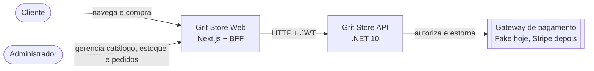
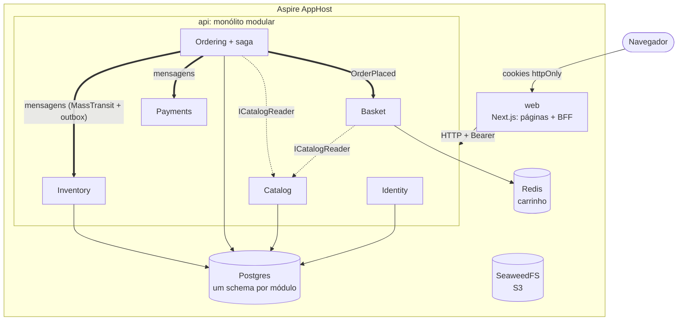
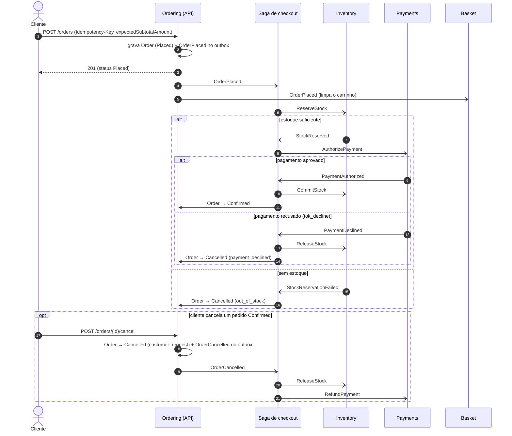

# Diagramas

Visão C4 (contexto e contêineres) e a sequência da saga de checkout. Os diagramas descrevem o código da `main` em 2026-10-16.

## Contexto

## Contêineres

Linhas tracejadas são leituras síncronas pelo `.Contracts` do módulo dono. Linhas grossas são mensagens assíncronas, publicadas pelo outbox de cada módulo na mesma transação da escrita (ADR 0005).

## Saga de checkout

O cliente acompanha o pedido por `GET /orders/{id}` até `Confirmed` ou `Cancelled`. O estado da saga, a mudança do pedido e o outbox são gravados na mesma transação (ADR 0015).
